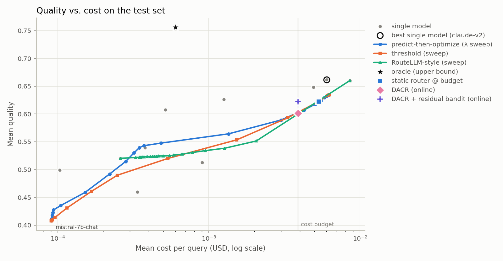
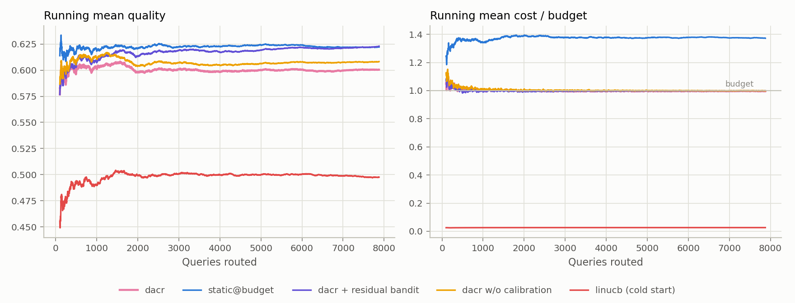

# Domain-Adaptive Calibrated Routing (DACR) for LLMs

[](https://github.com/JavadDogani/domain-adaptive-calibrated-routing/actions/workflows/ci.yml)
[](LICENSE)


**Domain-Adaptive Calibrated Routing (DACR)** picks, for every incoming prompt, which LLM should answer it so that answer quality stays high
while average cost (and optionally latency) stays within a budget. It combines

1. **calibrated per-model quality predictors.** Gradient-boosted classifiers on prompt embeddings,
   calibrated per *domain* with shrinkage toward a global calibrator. Domains can be dataset labels
   or unsupervised embedding clusters, so unseen domains still get a calibrator.
2. **leakage-free cost and latency estimates.** Each model's price sheet × the prompt length plus a
   *predicted* response length. The router never sees the true cost or latency of a test query.
3. **online budget pacing.** Lagrangian dual variables, updated as responses complete, keep average
   cost (and optionally latency) at the budget, even when traffic shifts to new domains.
4. **an optional residual contextual bandit.** A LinUCB variant learns where the calibrated
   predictor is wrong from **delayed and partly missing** quality feedback. It is reported as a
   variant, not the default, because it did not help on validation data (see *Results*).

The repository also includes a full evaluation harness on [RouterBench](https://huggingface.co/datasets/withmartian/routerbench)
(36k prompts × 11 LLMs) with standard baselines: single models, random, cheapest, threshold
routing, a RouteLLM-style strong/weak router, a MixLLM-style predict-then-optimize router, and the
oracle.

## Results on RouterBench

36,497 prompts × 11 LLMs (GPT-4-1106, GPT-3.5, Claude v1/v2/instant, Llama-2-70B, Mixtral, Mistral-7B,
Yi-34B, Code Llama 34B, WizardLM-13B). Cost budget is 50% of GPT-4's average cost per query. Online
numbers are mean ± std over 3 streams (arrival order, feedback delays and missing feedback differ).
All settings were chosen on validation data, not on these test sets. Reproduce with the commands in
[Reproduce on RouterBench](#reproduce-on-routerbench).

**In-distribution** (random split; 7,299 test prompts, budget $0.00400/query)

| router | quality | cost / query | % of budget |
|---|---:|---:|---:|
| GPT-4 alone (best single model) | 0.811 | $0.00792 | 198% |
| random model | 0.612 | $0.00226 | 56% |
| cheapest model | 0.500 | $0.00014 | 3% |
| RouteLLM-style strong/weak (threshold 0.5) | 0.667 | $0.00093 | 23% |
| static router @ budget (offline) | 0.797 | $0.00391 | 98% |
| **DACR** (online) | **0.795 ± 0.002** | $0.00392 | 98% |
| DACR + residual bandit (online) | 0.794 ± 0.002 | $0.00390 | 98% |
| *oracle (upper bound)* | *0.920* | *$0.00050* | *13%* |

**Out-of-distribution** (grade-school-math and mbpp held out of training and calibration; 7,877
test prompts, budget $0.00390/query)

| router | quality | cost / query | % of budget |
|---|---:|---:|---:|
| GPT-4 alone (best single model on training data) | 0.660 | $0.00859 | 220% |
| random model | 0.560 | $0.00209 | 54% |
| cheapest model | 0.411 | $0.00009 | 2% |
| RouteLLM-style strong/weak (threshold 0.5) | 0.524 | $0.00045 | 12% |
| static router @ budget (offline) | 0.622 | $0.00535 | **137%** |
| **DACR** (online) | **0.601 ± 0.001** | $0.00389 | 100% |
| DACR + residual bandit (online) | **0.622 ± 0.002** | $0.00390 | 100% |
| *oracle (upper bound)* | *0.756* | *$0.00060* | *15%* |

What the numbers say:

* **Routing pays off.** In-distribution, a calibrated router reaches 98% of GPT-4's quality at 49%
  of its cost.
* **Offline routers break their budget under domain shift. DACR does not.** The static router's cost
  multiplier is tuned on calibration data. On new domains it spends 137% of the budget. DACR's online
  pacing holds spending at 100%. At that cost it matches the best offline router *chosen in hindsight
  on the test set* (0.601 vs. 0.602), without needing hindsight.
* **Learning from delayed feedback helps under strong shift.** On GSM8K/MBPP, the residual bandit
  adds +2.1 points at the same cost. That is above every point of the offline quality–cost frontier
  (0.622 vs. 0.602). It gives no gain in-distribution and was slightly negative on the MMLU validation
  shift, so it is an option (`dacr + residual bandit`), not the default.
* **Calibration: honest negative result.** The soft-label GBDT is already well calibrated
  in-distribution (ECE 0.006). Embedding-cluster calibration helped slightly on validation. On the
  GSM8K/MBPP test it *hurt* (ECE 0.089 vs. 0.066 uncalibrated). Calibrators fitted on old domains do
  not transfer to genuinely new ones. Online adaptation does better there.
* **Headroom.** The oracle is far ahead (0.920 in-distribution). Prompt-only quality prediction is the
  bottleneck.

<p align="center">
  <br>
  
</p>

More figures (in-distribution frontier, reliability diagrams) are in [`docs/figures/`](docs/figures/).
Latency and SLO metrics are written to `offline_metrics.csv` / `online_metrics.csv`. They are not
shown here because latency on RouterBench is simulated (see *Evaluation protocol*).

## Install

```bash
git clone https://github.com/JavadDogani/domain-adaptive-calibrated-routing.git
cd domain-adaptive-calibrated-routing
python -m venv .venv && source .venv/bin/activate
pip install -e ".[all]"          # core + sentence-transformers + huggingface_hub + openai
# pip install -e ".[dev]"        # tests + linting only (no torch)
```

Python ≥ 3.10.

## Quickstart (synthetic data, ~10 seconds)

A small synthetic benchmark with known structure ships with the package, so you can try the full
pipeline without downloading anything:

```bash
dacr run --data synthetic --out results/demo
dacr route --router results/demo/router.joblib "solve the quadratic equation and prove it"
```

## Reproduce on RouterBench

```bash
# 1) download + convert RouterBench to a long table (one row per query x model)
dacr prepare --out data/routerbench.parquet

# 2) in-distribution: random split of queries
dacr run --data data/routerbench.parquet --out results/random --split random

# 3) out-of-distribution: hold out whole domains (prefix match on the domain name)
dacr run --data data/routerbench.parquet --out results/ood --split ood --holdout grade-school-math,mbpp
```

The first run embeds all prompts with `all-MiniLM-L6-v2` (about 10 minutes on CPU) and caches the
embeddings in `.cache/dacr/`, so later runs start in seconds. Use `--max-queries 5000` for a quick
look. `dacr run --help` lists every option (budget, SLO, arrival rate and bursts, feedback delay,
missing-feedback rate, bandit hyperparameters, ...).

> `dacr prepare` loads RouterBench's official pickle files. Unpickling runs code from the file, so
> only use files from the official dataset repository.

## How DACR works

For query *x* and model *a*:

```
score(a) = q̂_cal(x, a)                       domain-calibrated predicted quality (offline)
         − λ_c · ĉ(x, a) / B_c                cost penalty   (ĉ = price sheet × predicted length)
         − λ_l · l̂(x, a) / B_l                latency penalty (optional)
         [+ θ_a·z(x) + α·‖z(x)‖_{A_a⁻¹}]      residual bandit (optional variant)
route(x) = argmax_a score(a)
```

* **Calibration.** Per-model Platt scaling fitted on a held-out calibration split. A query in
  group *g* gets `w_g·cal_g(p) + (1−w_g)·cal_global(p)` with `w_g = n_g / (n_g + k)`.
  Groups are k-means clusters of prompt embeddings (default) or dataset domain labels.
* **Budgets.** `λ` starts at the value that meets the budget on the calibration split. It is then
  updated by projected dual ascent, `λ ← max(0, λ + η(c_t/B − 1))`, whenever a response completes.
  Spending stays at the budget even when the test distribution differs from calibration.
* **Delayed or missing feedback.** Cost and latency are observed when a response completes. Quality
  feedback (e.g. a user rating or judge score) arrives `Exp(mean delay)` seconds later, or never
  (`--missing-prob`). Only the residual-bandit variant uses quality feedback.
* **Residual bandit (variant).** One ridge regression per model on `z(x) = [1, cluster one-hot]`
  (`--bandit-features`), predicting `observed quality − q̂_cal`. Sherman–Morrison updates make each
  update O(d²).

Online policies reported by `dacr run`:

| policy | prior | online budget pacing | learns from quality feedback |
|---|---|---|---|
| `dacr` | domain-calibrated | yes | no |
| `dacr + residual bandit` | domain-calibrated | yes | yes |
| `dacr w/o calibration` | raw predictor | yes | no |
| `static@budget` | domain-calibrated | no (λ fixed on calibration data) | no |
| `linucb (cold start)` | none | yes | yes |

**How the defaults were chosen.** Calibration mode, bandit features, `α` and the ridge strength were
selected by a sweep on validation data only: the calibration split of the random split, and a
separate run that holds out all MMLU domains. Neither test set below was used for tuning.

## Evaluation protocol

* **Splits.** Train (fits predictors), calibration (fits calibrators and the budget λ), and test.
  In the OOD setting, test domains are absent from both train and calibration.
* **What the router sees.** Prompt text, prompt length, and each model's price sheet. Response
  length, cost and latency of a test query are *predicted*. Only the oracle uses ground truth.
* **Quality** is RouterBench's per-query score in [0, 1]. Graded scores (e.g. 0.25 or 0.75) are used
  as soft labels, not rounded.
* **Cost budget.** Default: 50% of the mean cost of the best single model (`--budget-frac`), or an
  absolute value with `--cost-budget`.
* **Latency is simulated.** RouterBench has no latency data and most of its models are retired. Each
  model gets a profile (time to first token, prefill and decode throughput, log-normal jitter, a
  slow-request tail). The built-in profiles are illustrative assumptions, not measurements. Measure
  your own endpoints with `dacr profile-latency` (below) and pass `--latency-profiles`.
* **Online replay.** Test queries arrive as a Poisson stream (`--rate-qps`, optional `--bursts`).
  All policies see the same arrivals, latencies and feedback delays (common random numbers). Results
  are averaged over `--online-seeds`.

## Outputs

`dacr run --out DIR` writes:

| file | content |
|---|---|
| `summary.md`, `summary.json` | headline table, budget, calibration, config |
| `offline_metrics.csv` | every offline policy and sweep setting: quality, cost, latency mean/p50/p95/p99, SLO violations |
| `online_metrics.csv`, `online_runs.csv` | online replay per policy (mean ± std over seeds, and per seed) |
| `calibration.csv` | ECE and Brier score per model × calibration method on the test split |
| `predictors.csv` | cost and latency estimation error per model |
| `per_domain.csv`, `model_shares.csv` | per-domain results and routing distribution of the main policies |
| `frontier.png`, `reliability.png`, `online.png` | quality–cost frontier, reliability diagram, online learning curves |
| `router.joblib` | the fitted router (see below) |

## Using a trained router

```bash
dacr route --router results/random/router.joblib "Write a Python function that merges two sorted lists"
```

```python
from dacr.router import Router

router = Router.load("results/random/router.joblib")
router.route(["What is the capital of Australia?"])  # -> ['<model name>']
router.explain("Prove that sqrt(2) is irrational")  # per-model quality / cost / latency estimates
router.route(prompts, lam_cost=0.0)  # ignore cost: best predicted quality
```

## Measuring real latency

`dacr profile-latency` streams a sample of prompts to any OpenAI-compatible endpoint (OpenAI,
vLLM, Ollama, ...). It records time to first token and total time, and fits a latency profile:

```bash
cp configs/endpoints.example.yaml configs/endpoints.yaml   # edit models / base URLs
export OPENAI_API_KEY=...
dacr profile-latency --endpoints configs/endpoints.yaml --prompts data/routerbench.parquet \
    --n-prompts 30 --out configs/latency_profiles.measured.yaml
dacr run --data data/routerbench.parquet --latency-profiles configs/latency_profiles.measured.yaml ...
```

Use the `name` field of an endpoint to map it onto the RouterBench model it should stand in for.

## Project layout

```
src/dacr/
  data.py          RouterBench loading, long table -> (query x model) matrices, splits
  features.py      prompt cleanup, embeddings (cached), meta features
  predictors.py    quality (soft-label GBDT), response length, price sheet, RouteLLM win model
  calibration.py   Platt, domain-adaptive group calibration, ECE / Brier
  domains.py       label- or cluster-based calibration groups
  latency.py       latency profiles and simulator
  policies.py      offline routers + budget-matching lambda
  bandit.py        residual LinUCB (Sherman–Morrison), dual variables
  online.py        discrete-event replay with delayed / missing feedback, DACR policy
  experiment.py    end-to-end experiment and reports
  router.py        savable router for new prompts
  profiling.py     latency measurement of OpenAI-compatible endpoints
  cli.py           `dacr` command
tests/             unit + end-to-end tests (synthetic data, no downloads)
configs/           example latency profiles and endpoint list
```

## Development

```bash
pip install -e ".[dev]"
pytest -q            # a few seconds; synthetic data only, no downloads
ruff check . && ruff format --check .
```

## Limitations

* Latency numbers on RouterBench come from the simulator, not from real API calls.
* RouterBench's models (GPT-4-1106, Claude 2, Llama-2-70B, ...) are from late 2023. The method
  carries over to current models, but the absolute numbers do not.
* Quality feedback in the online replay is RouterBench's ground-truth score, delivered with delay
  or dropped. Real user feedback is noisier and biased.

## License

MIT. See [LICENSE](LICENSE).
